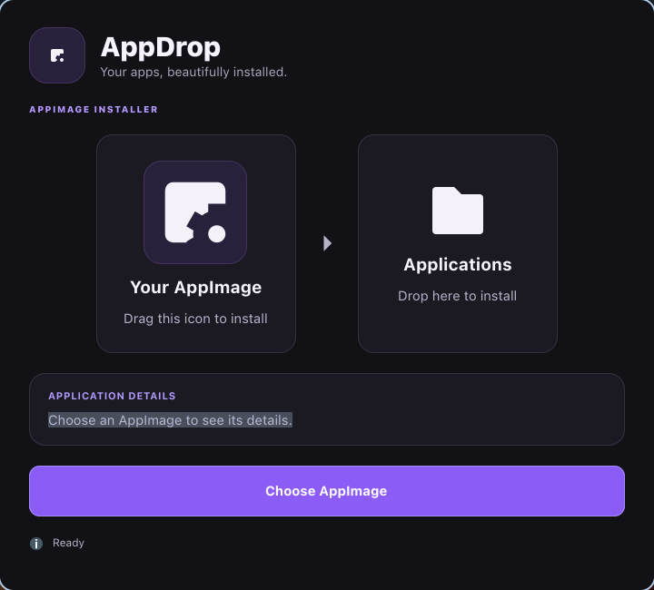
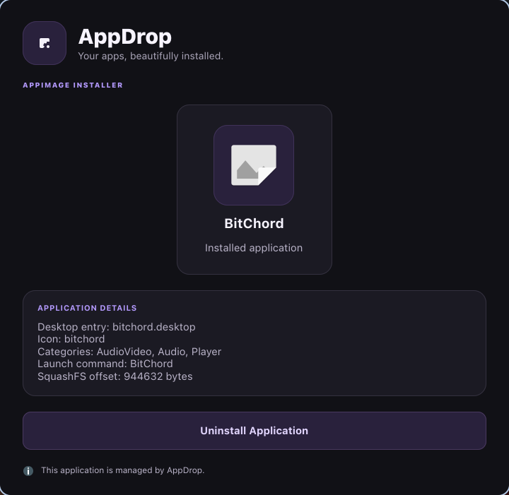

# AppDrop

A small GTK4 / libadwaita app for installing and managing AppImages on Linux. Open an AppImage with AppDrop, review what's inside, and install it. It then shows up in your application menu like any other app.

Everything is installed per user under `~/.local`. AppDrop needs no root access and never touches system directories.



## Features

- **One-click install.** Open an `.AppImage` (double-click, "Open With", or pass it as an argument) to see its name, version, description and icon, then install it.
- **Drag and drop.** Drop an AppImage onto the window, or drag the app icon into your file manager to install from there.
- **Menu integration.** Installs a `.desktop` entry and the app's icon (in the matching hicolor size) so the app appears in your launcher.
- **Update detection.** If the app is already installed, AppDrop compares versions and offers an *Update* instead of a fresh install.
- **Library.** Browse installed apps, launch them, or uninstall them cleanly.
- **Safe writes.** Files are written to a temporary path and moved into place, and uninstall only removes files under `~/.local`.



## How it works

AppDrop reads AppImage metadata with `unsquashfs` (from `squashfs-tools`). It finds the embedded SquashFS image, extracts the `.desktop` file and icon, and never runs the AppImage to inspect it.

| What | Where |
| --- | --- |
| AppImage | `~/.local/opt/appdrop/` |
| Desktop entry | `~/.local/share/applications/` |
| Icons | `~/.local/share/icons/hicolor/` |
| Install records | `~/.local/share/appdrop/` |

## Installation

### Arch Linux

```sh
cd packaging/arch
makepkg -si
```

### Debian / Ubuntu

Download the `.deb` from the [releases page](https://github.com/shahriar-ridom/appdrop/releases) and install it:

```sh
sudo apt install ./appdrop_<version>_amd64.deb
```

### Prebuilt binary

Releases also include a `appdrop-<version>-linux-x86_64.tar.gz`. Extract it and put `appdrop` somewhere on your `PATH`. You need GTK 4, libadwaita and `squashfs-tools` installed.

### From source

Requirements: a recent stable Rust toolchain (edition 2024), GTK 4 and libadwaita development headers, and `squashfs-tools`.

```sh
# Debian / Ubuntu
sudo apt install libgtk-4-dev libadwaita-1-dev squashfs-tools

# Arch
sudo pacman -S gtk4 libadwaita squashfs-tools
```

```sh
git clone https://github.com/shahriar-ridom/appdrop.git
cd appdrop
cargo build --release
./target/release/appdrop
```

## Usage

```sh
appdrop                      # open the library of installed apps
appdrop path/to/App.AppImage # review and install an AppImage
```

You can also right-click an AppImage in your file manager and choose AppDrop.

## Development

```sh
cargo run                      # run the app
cargo run -- path/to/App.AppImage
cargo test                     # run the unit tests
```

Source layout:

| File | Purpose |
| --- | --- |
| `src/main.rs` | Window, UI and event handling |
| `src/metadata.rs` | AppImage inspection via `unsquashfs` |
| `src/installer.rs` | Install, update, uninstall and launch |
| `src/library.rs` | Installed-apps view |
| `src/version.rs` | Version comparison |

## License

[MIT](LICENSE)
